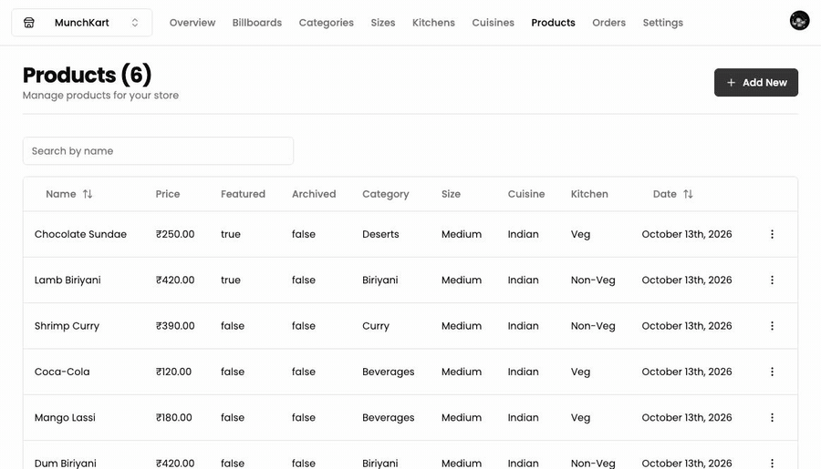

# MunchKart — Admin

The dashboard and backend for a multi-restaurant food ordering platform. One account can run several stores, each with its own menu, orders, pricing and revenue charts.

**[Live ↗](https://munch-kart-admin.vercel.app)** · storefront: **[MunchKart-Store](https://github.com/vibey19/MunchKart-Store)** ([live ↗](https://munch-kart-store.vercel.app))



> Built as my deliverable during a six-month full-stack internship at eSpectra Softweb Solutions (Nov 2024 – May 2025). The brief was to get menu and price changes out of the developer's inbox: store owners edit their own catalogue here instead of filing a ticket for every change.
>
> Client data and branding have been replaced with fixtures in this public copy.

## This repo is also the API

Worth knowing before reading the code: the admin app isn't only a dashboard. It owns the data and serves the storefront.

- **Firestore** holds every store, product and order. The storefront has no database of its own.
- **Stripe Checkout** sessions are created here, and the `/api/webhook` endpoint is what actually marks an order paid — not the browser redirect, which a customer can close or never reach.
- **`/api/[storeId]/*`** is a CORS-enabled REST API that the storefront reads over HTTP.

So the storefront stays a thin client, and anything that touches money or data lives on one side of the wire.

## What you can manage

Each store is namespaced under `[storeId]`, so the dashboard, the API and the permissions all key off the same route parameter.

| | |
|---|---|
| **Products** | name, price, images, featured and archived flags, plus category, size, kitchen and cuisine |
| **Taxonomy** | categories, cuisines, kitchens and sizes — the four axes the storefront filters its menu on |
| **Billboards** | the promo images the storefront renders on category pages |
| **Orders** | customer details, line items, payment state, and status moving through Processing → Delivering → Delivered |
| **Settings** | store name, and deleting the store |

Images upload to Firebase Storage straight from the form, and deleting a record cleans up the files behind it rather than orphaning them in the bucket.

## Analytics

The overview page reports:

- **total revenue**, counting paid orders only, so an abandoned checkout never inflates it
- **total sales** as a raw order count, and total products
- revenue broken down by category, and by order status
- a monthly revenue graph (Recharts)

## Stack


Next.js App Router · TypeScript · Firebase (Firestore + Storage) · Stripe · Clerk · Tailwind with Radix primitives · TanStack Table · React Hook Form with Zod · Recharts

## Running it locally

```bash
npm install
npm run dev
```

You'll need a `.env` with a Firebase web app, a Stripe test key and a Clerk application:

```ini
NEXT_PUBLIC_FIREBASE_API_KEY=
NEXT_PUBLIC_FIREBASE_AUTH_DOMAIN=
NEXT_PUBLIC_FIREBASE_PROJECT_ID=
NEXT_PUBLIC_FIREBASE_STORAGE_BUCKET=
NEXT_PUBLIC_FIREBASE_MESSAGING_SENDER_ID=
NEXT_PUBLIC_FIREBASE_APP_ID=

STRIPE_API_KEY=
STRIPE_WEBHOOK_SECRET=

NEXT_PUBLIC_CLERK_PUBLISHABLE_KEY=
CLERK_SECRET_KEY=

FRONTEND_STORE_URL=http://localhost:3001
```

Run the storefront on a different port (`next dev -p 3001`) and point its `NEXT_PUBLIC_API_URL` at `http://localhost:3000/api/<storeId>`.

For the webhook to fire against a local server, forward it with the Stripe CLI:

```bash
stripe listen --forward-to localhost:3000/api/webhook
```

Without that, checkout will complete and the order will stay unpaid — which is the behaviour you want in production, and the thing that confuses you most in development.
